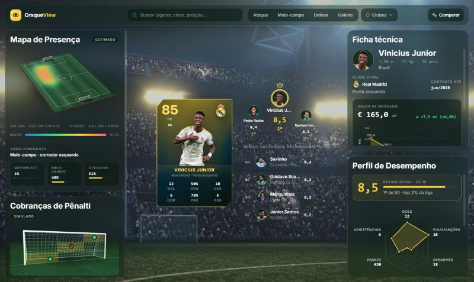
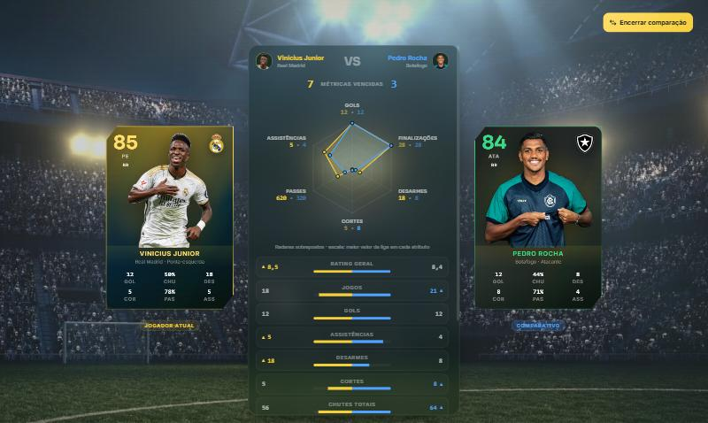

# ⚽ CraqueView

**Dashboard imersivo de estatísticas de jogadores do Brasileirão** — feito com HTML, CSS e JavaScript puros, sem frameworks e sem etapa de build.

🔗 **Demo ao vivo:** https://marcv8.github.io/craqueview/



---

## ✨ Funcionalidades

- **Ranking interativo** com pódio e lista rolável; reordena pela métrica que você clicar (rating, gols, desarmes, precisão de passe, valor de mercado…), e a ficha e a carta passam automaticamente para o 1º colocado.
- **Filtros cumulativos** por posição (ataque, meio-campo, defesa, goleiro) e por clube, em menu suspenso translúcido com seleção múltipla, combinados com a busca por texto.
- **Carta holográfica 3D** para cada jogador, com inclinação e reflexos que seguem o mouse (física de mola), cores do clube, faixa de raridade pelo rating e troca em *vertical swap* sequencial.
- **Ficha técnica** com dados físicos, clube, contrato e **gráfico de evolução do valor de mercado** com eixos, grade e marcadores.
- **Perfil de desempenho** com **radar de atributos** (no estilo dos games de futebol) e **medidores de precisão** coloridos (vermelho/amarelo/verde).
- **Mapa de presença em 3D**: um bloco de gramado flutuante com mapa de calor, feito só em CSS.
- **Cobranças de pênalti** sobre uma **goleira 3D em canvas** com a rede balançando ao vento.
- **Modo comparação**: dois jogadores lado a lado com **radares sobrepostos**, duelo métrica a métrica e transições em *slide*.
- **Fundo em vídeo** de estádio à noite, painéis em *glassmorphism* e animações suaves nos pontos dos gráficos.



## 🛠️ Tecnologias

| Camada | Uso |
|---|---|
| HTML5 | estrutura semântica, `<video>`, `<canvas>` |
| CSS3 | custom properties (tokens), grid/flex, `backdrop-filter`, transformações 3D, container queries, `color-mix()` |
| JavaScript (ES2020+) | renderização dos componentes, SVG gerado por código, Canvas 2D, Web Animations, interpolação de pontos |
| Google Fonts | Inter e Sora |

Não usa nenhuma biblioteca de gráficos: radar, linha, medidores e duelos são SVG gerados à mão.

## 📁 Estrutura

```
craqueview/
├── index.html            # o dashboard inteiro (CSS + HTML + dados + JS)
├── assets/
│   ├── background/       # vídeo de fundo
│   ├── jogadores/        # face_*.png (avatares) e card_*.png (cartas)
│   └── clubes/           # escudos
├── data/                 # CSVs de origem (jogadores e histórico de valor)
└── docs/
    ├── DESIGN.md         # sistema visual: paleta, tipografia, espaçamento
    └── *.jpg             # capturas para este README
```

## 🚀 Como rodar

É um site estático. Abra o `index.html` no navegador ou sirva a pasta com qualquer servidor estático, por exemplo:

```bash
npx serve .
```

### Publicar no GitHub Pages
1. Envie esta pasta para um repositório chamado `craqueview`.
2. Em **Settings → Pages**, escolha *Deploy from a branch*, depois `main` e `/ (root)`.
3. Em um ou dois minutos o site fica disponível em `https://<seu-usuario>.github.io/craqueview/`.

## 📊 Sobre os dados

- As estatísticas dos jogadores (`data/brasileirao_players_2026.csv`) e o histórico de valor de mercado vêm do material do curso e são **fictícias ou de exemplo**, não dados oficiais.
- O **mapa de presença** e as **cobranças de pênalti** são **estimados/simulados**, porque o dataset não tem essas informações. Eles são gerados de forma determinística a partir da posição e dos gols de cada jogador, e o dashboard sinaliza isso nos próprios cards.

## ⚖️ Créditos e avisos

- **Projeto de estudo, sem fins comerciais.** Fotos de jogadores, escudos de clubes e o vídeo de fundo pertencem aos seus respectivos detentores e foram usados só para fins educacionais. Se você for o detentor de algum desses direitos e quiser a remoção, abra uma *issue*.
- O mecanismo de movimento 3D e iluminação da carta holográfica foi adaptado de [pokemon-cards-css](https://github.com/simeydotme/pokemon-cards-css), de Simon Goellner (licença MIT). O design visual é próprio.
- Os elementos 3D (campo, goleira e carta) partiram dos protótipos do curso e foram adaptados e integrados ao dashboard.

## 🧠 O que aprendi

- Montar um **design system** com tokens CSS e aplicá-lo com disciplina em todos os componentes.
- Desenhar **gráficos em SVG** (radar, linha com eixos, medidores) sem bibliotecas.
- Criar **profundidade 3D** só com CSS e com Canvas 2D (projeção em perspectiva).
- Orquestrar **animações sequenciais** (*vertical swap*, entradas e saídas em *slide*, interpolação de pontos).
- Lidar com **estado de interface**: filtros cumulativos, ordenação por métrica e modo de comparação.

---

Feito por **[marcv8](https://github.com/marcv8)**.
